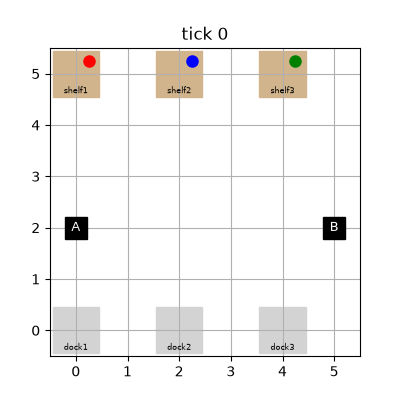

# sparql-bt-agents



Warehouse robots driven by behavior trees, with the whole world state kept in a single RDF graph. Behavior-tree conditions are SPARQL `ASK` queries, and every action reads and writes the graph.

## Setup

```
python -m venv .venv
.venv\Scripts\activate
pip install -e ".[dev]"
```

## Run the demo

```
python -m sbt.render
```

This runs the two-robot demo and saves the animation to `results/demo.gif`.

## Tests

```
pytest
```
