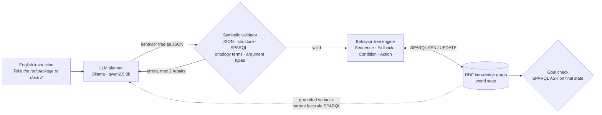

# sparql-bt-agents

**LLM-generated behavior trees for knowledge-graph agents, checked by a symbolic validator before they run.**


Two warehouse robots keep their entire world state in one **RDF knowledge graph**. They act through **behavior trees** whose conditions are **SPARQL `ASK`** queries and whose actions are **SPARQL `UPDATE`s**. A small local LLM translates English instructions into these behavior trees. Before a tree runs, a **symbolic validator** checks it against the ontology. If it finds errors, the errors go back to the LLM in a **repair loop**. Optionally, the planner is **grounded**: the current facts from the knowledge graph are retrieved with SPARQL and added to the LLM request.

The questions this project measures:

> **How reliably can a small local LLM write executable agent behaviors for a semantic-web agent? How much does ontology-based validation with feedback help, and how much does grounding the LLM in the current graph state help?**

### Key findings (qwen2.5:3b, 20 tasks, 4 variants)
- **The validator found 0 errors in all 4 variants.** Every tree was well-formed, so the repair loop never ran.
- **Without grounding, 7/20 tasks succeeded.** All 13 failures were well-formed but wrong. 8 sent a robot to the wrong shelf, because the model was told which shelves exist but not where the packages are.
- **State grounding raised success from 7/20 to 13/20** (instructions: 13/26 → 19/26), with no task getting worse. Wrong-shelf errors dropped from 8 to 0.
- **The 7 remaining failures are all about plan logic:** 4 backup plans in the wrong place, plus one each of a missing step, a wrong step order and an impossible condition. Grounding fixes **missing knowledge**; it does not fix **wrong plan structure**.

---

## Motivation

The project is inspired by **AJAN**, the semantic-web multi-agent framework from DFKI's *Agents and Simulated Reality* department. In AJAN, agent knowledge is stored in RDF and behaviors are modelled as SPARQL behavior trees. Recent work by Hechehouche, Antakli and Klusch adds an LLM interface that generates these behaviors from natural language. Writing correct SPARQL and using the right IRIs are known difficulties in that setting.

This repository is a deliberately small, fully reproducible version of that idea. It isolates one question: **what kinds of mistakes does an LLM make when it writes agent behaviors, and which of them can a symbolic checker or the knowledge graph itself prevent?**

---

## How it works



| Component | File | What it does |
|---|---|---|
| Ontology + world | `data/warehouse.ttl` | Classes (`Robot`, `Package`, `Place` ⊃ `Shelf`, `Dock`), properties, and the starting state of a 6×6 grid |
| Knowledge base | `src/sbt/kb.py` | Loads the graph; helpers for SPARQL `ASK`/`UPDATE`, known ontology terms, subclass-aware type checks, and `state_facts` (current state as text, for grounding) |
| Simulation | `src/sbt/world.py` | Robot actions `move_to`, `claim`, `pick`, `drop`. Each checks its preconditions in the graph and writes its effects back |
| Behavior trees | `src/sbt/bt.py` | Sequence and Fallback (with memory), SPARQL Condition, Action; JSON → tree; multi-robot tick loop |
| Validator | `src/sbt/validator.py` | Rejects a tree before execution (6 error types, below) |
| Planner | `src/sbt/planner.py` | Few-shot prompt to a local LLM via Ollama; optional state grounding; optional validate-and-repair loop |
| Experiment | `src/sbt/evaluate.py` | Runs every task in the selected variants and writes JSON results plus a summary table |
| Analysis | `src/sbt/analyze.py` | Recomputes all numbers and re-executes failed trees to log the first failing condition or action |
| Visualisation | `src/sbt/render.py` | Animated GIF of a run |

### Design decisions

- **The knowledge graph is the only world state.** No Python object holds a copy of the world. Conditions, actions, the goal check, the grounding facts and the renderer all read the same graph.
- **Multi-agent coordination through the graph (blackboard).** Robots never message each other. A robot reserves a package by writing `ex:claimedBy`, and `claim` fails if another robot has already done so.
- **Sequence and Fallback with memory.** A running child resumes on the next tick instead of re-checking earlier conditions. Without this, a precondition like "the package is on the shelf" becomes false after picking and the plan would abort halfway.
- **Success is measured on the world, not on the text.** Each task has a goal `ASK` query, evaluated on the final graph after execution.
- **Grounding reads the graph after the task's setup.** The facts in the prompt (`ex:isAt`, `ex:heldBy`, `ex:claimedBy`, `ex:status`) are always the true current state of that task, retrieved with one SPARQL `SELECT`.

### What the validator checks

| Error type | Catches | Example |
|---|---|---|
| `json_error` | Output is not valid JSON | Prose around the JSON |
| `structure_error` | Wrong tree shape or unknown node type | A `sequence` without children |
| `sparql_error` | SPARQL does not parse, or is not an `ASK` | `ASK { ex:redPackage ex:isAt ` |
| `unknown_term` | IRIs not in the ontology (hallucinations) | `ex:dock7` |
| `unknown_action` | Actions the robot does not have | `fly` |
| `type_error` | A real term of the wrong class | `pick ex:dock1` (a Dock is not a Package) |

The validator checks **form and vocabulary**. It does not check whether the plan's **logic** is right (missing steps, wrong order, missing backup plan). The failure analysis below measures exactly that gap.

---

## Benchmark

20 tasks (`tasks/tasks.json`), 26 robot instructions in total. Each task can change the starting world with SPARQL `UPDATE`s and defines success as a SPARQL `ASK` on the final state.

| Level | What it tests | Tasks |
|---|---|---|
| **L1** | One robot, one delivery | 7 |
| **L2** | Conditions and backup plans: busy docks, a package in an unexpected place, a package already claimed | 7 |
| **L3** | Two robots at once, including conflicts over the same package | 6 |

Some tasks use the **same instruction in different worlds** (e.g. L2-01 vs. L2-02: dock 2 busy vs. free). A correct tree must react to the graph, not just follow the most likely path.

**Variants**

| Variant | Graph facts in prompt | Repair loop |
|---|---|---|
| **direct** | no | no |
| **repair** | no | yes, up to 2 rounds |
| **grounded** | yes | no |
| **grounded_repair** | yes | yes, up to 2 rounds |

Only one thing changes between `direct` and `grounded`: the facts. The model, tasks, examples, validator and settings are identical.

---

## Results

<!-- RESULTS:START -->
**Setup:** `qwen2.5:3b` (Ollama, Q4, CPU-only laptop), temperature 0, one sample per task, 20 tasks / 26 robot instructions, at most 2 repair rounds.

| Variant | Valid trees | Task success | Instructions succeeded | Avg repairs |
|---|---|---|---|---|
| direct | 20/20 | 7/20 | 13/26 | 0.00 |
| repair | 20/20 | 7/20 | 13/26 | 0.00 |
| **grounded** | 20/20 | **13/20** | **19/26** | 0.00 |
| **grounded_repair** | 20/20 | **13/20** | **19/26** | 0.00 |

| Level | direct | repair | grounded | grounded_repair |
|---|---|---|---|---|
| L1: single delivery | 4/7 | 4/7 | **7/7** | **7/7** |
| L2: conditions and backup plans | 3/7 | 3/7 | 3/7 | 3/7 |
| L3: two robots | 0/6 | 0/6 | **3/6** | **3/6** |

- **Validation:** every tree in every variant passed the validator on the first attempt (0 errors across 4 × 26 instructions). The repair loop never ran, so each repair variant produced exactly the same trees as its non-repair counterpart.
- **Grounding:** 6 tasks went from failure to success (L1-03, L1-05, L1-07, L3-01, L3-05, L3-06) and **no task went from success to failure**. All the gains are in L1 and L3. L2 stays at 3/7, because its remaining failures are structural.

Full tables: [`results/summary_qwen2.5_3b.md`](results/summary_qwen2.5_3b.md) · per-task analysis: [`results/failure_analysis_qwen2.5_3b.md`](results/failure_analysis_qwen2.5_3b.md) · reproduce the numbers: `python -m sbt.analyze --variant direct` / `--variant grounded`
<!-- RESULTS:END -->

---

## Failure analysis

<!-- ANALYSIS:START -->
Each failed tree was re-executed in the simulation to find the first condition or action that failed. Each failure was then assigned one category by inspection.

| Category | direct | grounded | Catchable by the validator? |
|---|---|---|---|
| Invalid term / action / type | 0 | 0 | yes |
| Broken SPARQL / JSON / structure | 0 | 0 | yes |
| **Wrong package location**: robot sent to the wrong shelf | **8** | **0** | no |
| **Missing or misplaced backup plan** | 4 | 4 | no |
| **Missing step**: `pick` without `claim` | 1 | 1 | no |
| **Wrong step order**: e.g. `drop` before `pick` | 0 | 1 | no |
| **Impossible condition**: valid terms, meaningless triple | 0 | 1 | no |
| **Total failed tasks** | **13** | **7** | |

### 1. Without grounding, the model guessed where things are
The validator caught 0 errors: given the exact vocabulary in the prompt and JSON-constrained decoding, this 3B model did not hallucinate IRIs, actions or argument types. All 13 failures were **logically wrong yet well-formed**. The dominant failure (8/13) was **missing state knowledge**: the prompt said *which shelves exist* but not *which package is on which shelf*. The model sent robots to `shelf1` for the green package 8 times and to `shelf3`, where it actually is, 0 times.

### 2. Grounding removed every location error
With the current graph facts in the prompt, the model sent the green package's robot to `shelf3` in **9 of 9** cases, and **wrong-location failures dropped from 8 to 0**. One side effect: L1-07 (a missing `claim` without grounding) also succeeded.

| Task | Without grounding | With grounding |
|---|---|---|
| L1-03, L1-05, L3-01, L3-05, L3-06 | wrong shelf | ✅ success |
| L1-07 | missing `claim` | ✅ success |
| L2-03 | wrong shelf | impossible condition |
| L2-06 | wrong shelf | wrong step order |
| L3-02 | wrong shelf | missing `claim` |
| L2-05, L2-07, L3-03, L3-04 | backup plan | backup plan (unchanged) |

Three tasks moved from "wrong shelf" to a **different logic error**: the knowledge problem was fixed, which uncovered a structural one.

### 3. What grounding cannot fix: plan structure
The **same four tasks** failed on backup plans in both variants. The model writes correct fallbacks for **busy docks** (L2-01, L2-02, L2-04 succeed), but not around an action that can fail, such as `claim`, or around an uncertain package location.

**Example: L3-04, misplaced backup plan** (grounded run). robotB is told: *"Bring the blue package to dock 3. If it is already claimed, bring the green package to dock 3."* robotA claims blue first, as intended. robotB's tree:

```json
{"type": "sequence", "children": [
  {"type": "action", "name": "claim", "arg": "ex:bluePackage"},
  {"type": "action", "name": "move_to", "arg": "ex:shelf2"},
  {"type": "action", "name": "pick", "arg": "ex:bluePackage"},
  {"type": "fallback", "children": ["...dock 3 / green-package options..."]}]}
```

`claim ex:bluePackage` fails, so the sequence stops before the fallback is ever reached. The correct shape is `fallback(sequence(claim blue, …), sequence(claim green, …))`. Every term is valid and only the structure is wrong.

**Example: L2-03, impossible condition** (grounded run). robotB's tree starts with `ASK { ex:shelf3 ex:isAt ex:robotA }`: subject and object are swapped, and it names the wrong robot. Every IRI exists, so the vocabulary check passes, but a shelf can never be `isAt` a robot. A validator that knew the **domain and range** of `ex:isAt` (`rdfs:domain`/`rdfs:range`) could reject this triple before execution.

**Example: L2-06, wrong step order** (grounded run). The model used the facts correctly and chose `dock1`, the only free dock. But it placed `move_to dock1 → drop` *before* `move_to shelf3 → pick`, so `drop` fails because the robot is not holding anything.

**Takeaway.** The errors split into three layers, and each needs a different fix:

| Layer | Example | Fix | Status here |
|---|---|---|---|
| Vocabulary | invented IRIs or actions | ontology validator | no such errors occurred |
| World knowledge | wrong shelf | **state grounding** from the graph | 8 → 0 |
| Plan logic | misplaced fallback, wrong order, missing step | **simulation-based checking** (next step) | 7 remain |

Because the simulation is deterministic, a dry run of each tree on a copy of the graph would flag all 7 remaining failures before execution, and the first failing action could be returned to the LLM as repair feedback.
<!-- ANALYSIS:END -->

---

## Run it yourself

Requirements: Python ≥ 3.10 and [Ollama](https://ollama.com) with a local model.

```bash
git clone https://github.com/Salman-ds/sparql-bt-agents.git
cd sparql-bt-agents
python -m venv .venv
.venv\Scripts\activate            # Linux/macOS: source .venv/bin/activate
pip install -e ".[dev]"
ollama pull qwen2.5:3b
```

```bash
pytest -q                                              # 8 tests: graph, world rules, behavior trees, grounding facts, validator
python -m sbt.render                                   # two-robot demo → results/demo.gif
python -m sbt.planner                                  # one instruction → generated tree + validator verdict
python -m sbt.evaluate --only L2-01                    # a single task, all variants (saved to its own file)
python -m sbt.evaluate --model qwen2.5:3b              # full benchmark, all 4 variants → results/
python -m sbt.evaluate --variants grounded             # run selected variants; keeps the others in the results file
python -m sbt.analyze --variant grounded               # numbers + first failing action per failed task
```

Two variants take about 25–40 minutes on a CPU-only laptop.

---

## Repository structure

```
data/warehouse.ttl        ontology + initial world state (RDF/Turtle)
src/sbt/                  kb · world · bt · validator · planner · evaluate · analyze · render
tasks/tasks.json          the 20 benchmark tasks
tests/                    unit tests (no LLM needed)
results/                  summary tables, per-task JSON, failure analysis, demo GIF
```

---

## Limitations

- A small, fictional world (6×6 grid, 2 robots, 3 packages, 6 places) and 20 tasks. The results show the *kinds* of errors a model makes; they are not precise estimates of error rates.
- One small model, run at temperature 0 with a **single sample per task**. There are no confidence intervals. The model is also **sensitive to prompt wording**: during development, a version with a slightly different heading for the facts produced a different result on L3-02. Differences of one or two tasks should not be over-interpreted.
- The validator checks syntax and vocabulary, not plan logic, by design.
- Grounding makes L2-05 easier ("check where the red package is"), because the prompt states the location. The task still failed (the tree checks `shelf1` first, in a plain sequence).
- A task with two robots counts as successful only if both plans succeed.
- The behavior-tree format is a simplified JSON form, not AJAN's actual RDF-based behavior-tree vocabulary.

## Next steps

- **Simulation-based repair:** dry-run each candidate tree on a copy of the graph and send the first failing action back to the LLM as repair feedback. This targets the 7 plan-logic failures that remain after grounding.
- **Domain/range validation:** add `rdfs:domain` and `rdfs:range` to the ontology and check every triple pattern in a condition. This would catch impossible conditions like `ex:shelf3 ex:isAt ex:robotA` symbolically.
- **Fallback templates:** show the model the "fallback around a failing claim" pattern explicitly, and measure whether the 4 backup-plan failures disappear.
- Compare larger models (e.g. `qwen2.5:7b`), several samples per task with confidence intervals, and paraphrased prompts.
- Express behavior trees in RDF so plans themselves live in the knowledge graph, as in AJAN.

---

## Reference

A. Hechehouche, A. Antakli, M. Klusch. *LLM-Assisted Modeling of Semantic Web-Enabled Multi-Agent Systems with AJAN.* arXiv:2510.06911, 2025.

*Independent student project, inspired by the AJAN framework. It is not affiliated with DFKI and does not use AJAN code.*

## Author

**Muhammad Salman Manzoor**, M.Sc. Natural Language Processing, University of Trier
[GitHub](https://github.com/Salman-ds) · [LinkedIn](https://www.linkedin.com/in/isalman-manzoor/)

## License

MIT
