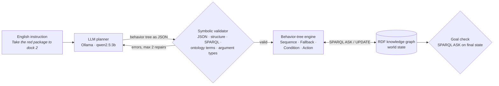

# sparql-bt-agents

**LLM-generated behavior trees for knowledge-graph agents, checked by a symbolic validator before they run.**


Two warehouse robots keep their entire world state in one **RDF knowledge graph**. They act through **behavior trees** whose conditions are **SPARQL `ASK`** queries and whose actions are **SPARQL `UPDATE`s**. A small local LLM translates English instructions into these behavior trees. Before a tree runs, a **symbolic validator** checks it against the ontology. If it finds errors, the errors go back to the LLM in a **repair loop**.

The question this project measures:

> **How reliably can a small local LLM write executable agent behaviors for a semantic-web agent, and how much does ontology-based validation with feedback help?**

### Key findings (qwen2.5:3b, 20 tasks)
- **20/20 trees were valid, but only 7/20 tasks succeeded.** The validator found 0 errors, so the repair loop never ran.
- **All 13 failures were well-formed but wrong:** 8 sent a robot to the wrong shelf (the model was not given the world state), 4 had a backup plan in the wrong place, and 1 skipped a required step.
- **Conclusion:** ontology validation guards vocabulary, but the real errors were in world state and plan logic. The next step is simulation-based checking and state grounding.

---

## Motivation

The project is inspired by **AJAN**, the semantic-web multi-agent framework from DFKI's *Agents and Simulated Reality* department. In AJAN, agent knowledge is stored in RDF and behaviors are modelled as SPARQL behavior trees. Recent work by Hechehouche, Antakli and Klusch adds an LLM interface that generates these behaviors from natural language. Writing correct SPARQL and using the right IRIs are known difficulties in that setting.

This repository is a deliberately small, fully reproducible version of that idea. It isolates one question: **what kinds of mistakes does an LLM make when it writes agent behaviors, and which of them can a symbolic checker catch?**

---

## How it works



| Component | File | What it does |
|---|---|---|
| Ontology + world | `data/warehouse.ttl` | Classes (`Robot`, `Package`, `Place` ⊃ `Shelf`, `Dock`), properties, and the starting state of a 6×6 grid |
| Knowledge base | `src/sbt/kb.py` | Loads the graph; helpers for SPARQL `ASK`/`UPDATE`, known ontology terms, and subclass-aware type checks |
| Simulation | `src/sbt/world.py` | Robot actions `move_to`, `claim`, `pick`, `drop`. Each checks its preconditions in the graph and writes its effects back |
| Behavior trees | `src/sbt/bt.py` | Sequence and Fallback (with memory), SPARQL Condition, Action; JSON → tree; multi-robot tick loop |
| Validator | `src/sbt/validator.py` | Rejects a tree before execution (6 error types, below) |
| Planner | `src/sbt/planner.py` | Few-shot prompt to a local LLM via Ollama; optional validate-and-repair loop |
| Experiment | `src/sbt/evaluate.py` | Runs every task in both variants and writes JSON results plus a summary table |
| Analysis | `src/sbt/analyze.py` | Recomputes all numbers and re-executes failed trees to log the first failing condition or action |
| Visualisation | `src/sbt/render.py` | Animated GIF of a run |

### Design decisions

- **The knowledge graph is the only world state.** No Python object holds a copy of the world. Conditions, actions, the goal check and the renderer all read the same graph.
- **Multi-agent coordination through the graph (blackboard).** Robots never message each other. A robot reserves a package by writing `ex:claimedBy`, and `claim` fails if another robot has already done so.
- **Sequence and Fallback with memory.** A running child resumes on the next tick instead of re-checking earlier conditions. Without this, a precondition like "the package is on the shelf" becomes false after picking and the plan would abort halfway.
- **Success is measured on the world, not on the text.** Each task has a goal `ASK` query, evaluated on the final graph after execution.

### What the validator checks

| Error type | Catches | Example |
|---|---|---|
| `json_error` | Output is not valid JSON | Prose around the JSON |
| `structure_error` | Wrong tree shape or unknown node type | A `sequence` without children |
| `sparql_error` | SPARQL does not parse, or is not an `ASK` | `ASK { ex:redPackage ex:isAt ` |
| `unknown_term` | IRIs not in the ontology (hallucinations) | `ex:dock7` |
| `unknown_action` | Actions the robot does not have | `fly` |
| `type_error` | A real term of the wrong class | `pick ex:dock1` (a Dock is not a Package) |

The validator checks **form and vocabulary**. It does not check whether the plan's **logic** is right (missing steps, wrong order, missing backup plan). The failure analysis below measures exactly that gap.

---

## Benchmark

20 tasks (`tasks/tasks.json`), 26 robot instructions in total. Each task can change the starting world with SPARQL `UPDATE`s and defines success as a SPARQL `ASK` on the final state.

| Level | What it tests | Tasks |
|---|---|---|
| **L1** | One robot, one delivery | 7 |
| **L2** | Conditions and backup plans: busy docks, a package in an unexpected place, a package already claimed | 7 |
| **L3** | Two robots at once, including conflicts over the same package | 6 |

Some tasks use the **same instruction in different worlds** (e.g. L2-01 vs. L2-02: dock 2 busy vs. free). A correct tree must react to the graph, not just follow the most likely path.

**Variants**
- **direct**: one LLM call; the tree is executed only if it is valid.
- **repair**: validator errors are sent back to the LLM, up to 2 repair rounds.

---

## Results

<!-- RESULTS:START -->
**Setup:** `qwen2.5:3b` (Ollama, Q4, CPU-only laptop), temperature 0, 20 tasks / 26 robot instructions, at most 2 repair rounds.

| Variant | Valid trees | Task success | Avg repairs |
|---|---|---|---|
| direct | 20/20 | **7/20** | 0.00 |
| validate + repair | 20/20 | **7/20** | 0.00 |

| Level | direct: success | repair: success |
|---|---|---|
| L1: single delivery | 4/7 | 4/7 |
| L2: conditions and backup plans | 3/7 | 3/7 |
| L3: two robots | 0/6 | 0/6 |

**Every generated tree passed the validator on the first attempt** (0 validator errors across 26 instructions). The repair loop therefore never ran, and both variants produced identical trees and identical results. Yet **13 of 20 tasks failed** when executed. At the instruction level, 13 of 26 robot plans succeeded. In every two-robot task, exactly one of the two plans worked.

Full tables: [`results/summary_qwen2.5_3b.md`](results/summary_qwen2.5_3b.md) · per-task analysis: [`results/failure_analysis_qwen2.5_3b.md`](results/failure_analysis_qwen2.5_3b.md) · reproduce the numbers: `python -m sbt.analyze`
<!-- RESULTS:END -->

---

## Failure analysis

<!-- ANALYSIS:START -->
Each failed tree was re-executed in the simulation to find the first condition or action that failed. Each failure was then assigned one category by inspection.

| Category | Failed tasks | Catchable by the validator? |
|---|---|---|
| Invalid term / action / type | 0 | yes |
| Broken SPARQL / JSON / structure | 0 | yes |
| **Wrong package location**: robot sent to the wrong shelf | **8** | no |
| **Missing or misplaced backup plan** | **4** | no |
| **Missing step**: `pick` without `claim` | **1** | no |

**What the numbers say.** The validator caught 0 errors: given the exact vocabulary in the prompt and JSON-constrained decoding, this 3B model did not hallucinate IRIs, actions or argument types. All 13 failures were **logically wrong yet well-formed**, which a syntax/ontology validator cannot detect by design. The dominant failure (8/13) is **state grounding**: the prompt tells the model *which shelves exist*, but not *which package is on which shelf*. The model sent robots to `shelf1` for the green package 8 times and never to `shelf3`, where it actually is, even though a few-shot example shows exactly that. The second pattern (4/13) is structural: the model writes correct fallbacks for busy docks, but not around an action that can fail, such as `claim`.

**Example: L3-04, misplaced backup plan.** robotB is told: *"Bring the blue package to dock 3. If it is already claimed, bring the green package to dock 3."* robotA claims blue first, as intended. robotB's tree starts with a plain sequence:

```json
{"type": "sequence", "children": [
  {"type": "action", "name": "claim", "arg": "ex:bluePackage"},
  {"type": "action", "name": "move_to", "arg": "ex:shelf2"},
  {"type": "action", "name": "pick", "arg": "ex:bluePackage"},
  {"type": "fallback", "children": ["...dock 3 / green-package options..."]}]}
```

`claim ex:bluePackage` fails, so the sequence stops before the fallback is ever reached. The correct shape is `fallback(sequence(claim blue, …), sequence(claim green, …))`. Every term is valid and only the tree structure is wrong.

**Example: L1-03, wrong package location.** *"Bring the green package to dock 3."* The tree is well-formed (`claim → move_to shelf1 → pick → move_to dock3 → drop`), but the green package is on `shelf3`, so `pick` fails at `shelf1`.

**Takeaway.** For this model and setup, ontology-based validation is necessary but **not sufficient**: it guards vocabulary, while the real errors were in **world state and plan logic**. Because the simulation is deterministic, a **dry run of each tree on a copy of the graph** would flag all 13 failures before execution and could return the failing action ("`pick ex:greenPackage` failed at `shelf1`") as repair feedback. That, plus putting the relevant graph facts into the prompt, are the next steps below.
<!-- ANALYSIS:END -->

---

## Run it yourself

Requirements: Python ≥ 3.10 and [Ollama](https://ollama.com) with a local model.

```bash
git clone https://github.com/Salman-ds/sparql-bt-agents.git
cd sparql-bt-agents
python -m venv .venv
.venv\Scripts\activate            # Linux/macOS: source .venv/bin/activate
pip install -e ".[dev]"
ollama pull qwen2.5:3b
```

```bash
pytest -q                                      # 7 tests: graph, world rules, behavior trees, validator
python -m sbt.render                           # two-robot demo → results/demo.gif
python -m sbt.planner                          # one instruction → generated tree + validator verdict
python -m sbt.evaluate --only L2-01            # a single task, both variants
python -m sbt.evaluate --model qwen2.5:3b      # full benchmark → results/
python -m sbt.analyze --model qwen2.5:3b       # numbers + first failing action per failed task
```

The full benchmark takes about 30–60 minutes on a CPU-only laptop.

---

## Repository structure

```
data/warehouse.ttl        ontology + initial world state (RDF/Turtle)
src/sbt/                  kb · world · bt · validator · planner · evaluate · analyze · render
tasks/tasks.json          the 20 benchmark tasks
tests/                    unit tests (no LLM needed)
results/                  summary tables, per-task JSON, demo GIF
```

---

## Limitations

- A small, fictional world (6×6 grid, 2 robots, 3 packages, 6 places) and 20 tasks. The results show the *kinds* of errors a model makes; they are not precise estimates of error rates.
- One small model family, run at temperature 0 with a single sample per task. There are no confidence intervals yet.
- The validator checks syntax and vocabulary, not plan logic, by design.
- The planner prompt lists the ontology vocabulary but not the current world state, so package locations had to be inferred. This explains most failures, and adding the state is the first next step.
- A task with two robots counts as successful only if both plans succeed.
- The behavior-tree format is a simplified JSON form, not AJAN's actual RDF-based behavior-tree vocabulary.

## Next steps

- **Simulation-based repair:** dry-run each candidate tree on a copy of the graph and send the first failing action back to the LLM as repair feedback. This targets exactly the 13 well-formed but wrong plans found here.
- **State grounding:** add the relevant graph facts (e.g. `redPackage isAt shelf1`, the dock statuses) to the prompt, retrieved with SPARQL. This tests how much of the 8/13 location errors disappears.
- Compare larger models (e.g. `qwen2.5:7b`) with a smaller model plus the validator.
- Several samples per task, with confidence intervals.
- Express behavior trees in RDF so plans themselves live in the knowledge graph, as in AJAN.

---

## Reference

A. Hechehouche, A. Antakli, M. Klusch. *LLM-Assisted Modeling of Semantic Web-Enabled Multi-Agent Systems with AJAN.* arXiv:2510.06911, 2025.

*Independent student project, inspired by the AJAN framework. It is not affiliated with DFKI and does not use AJAN code.*

## Author

**Muhammad Salman Manzoor**, M.Sc. Natural Language Processing, University of Trier
[GitHub](https://github.com/Salman-ds) · [LinkedIn](https://www.linkedin.com/in/isalman-manzoor/)

## License

MIT
